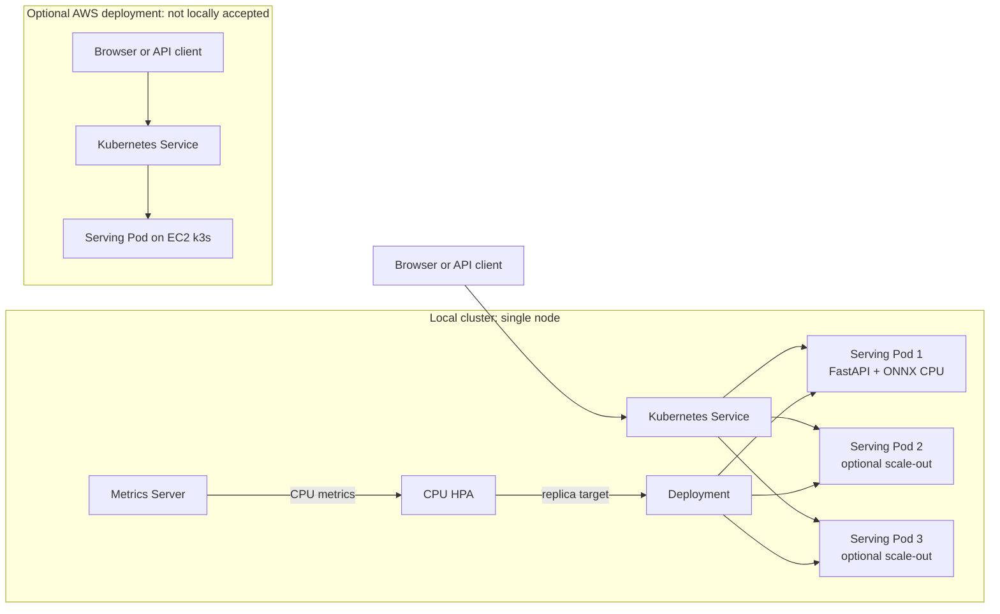

# Architecture

## Components

- **FastAPI application:** routes, auth and body-limit middleware, lifecycle,
  readiness, bounded concurrency, metrics, and sanitized structured logs.
- **Model registry:** one allowlisted `yolov8n` specification pins the public
  ONNX release URL, tag, byte size, SHA-256, input size, and license.
- **Inference:** ONNX Runtime CPU loads and warms the model once per process.
  Pillow decodes JPEG/PNG/WebP; NumPy preprocesses and postprocesses detections.
- **Studio:** same-origin static UI with image preview, box canvas, accessible
  detection table, and a session-memory-only API key.
- **Runtime:** one Uvicorn worker per container. Kubernetes adds Pods; a
  bounded semaphore limits concurrent inference within each Pod.
- **Infrastructure:** Docker, Kubernetes/HPA, k6 experiment tooling, and
  optional Terraform plus GitHub OIDC/SSM deployment to one EC2 k3s node.

## Request and scaling topology

The AWS client/service/Pod path is separate from the tested local request path.
The local replicas share one node; scaling replicas does not add node CPU or
establish high availability.

## Request path

1. Auth middleware rejects an invalid key before reading a protected body.
2. Body-limit middleware bounds declared and streamed request bytes.
3. `/api/detect` validates query parameters and media type, checks readiness,
   reads the bounded body, and only then attempts to acquire a slot.
4. The worker decodes and validates image signature, dimensions, and animation;
   applies EXIF orientation; converts to RGB; and letterboxes to 640 by 640.
5. ONNX Runtime performs CPU inference with a native termination deadline.
   Postprocessing applies class-aware NMS and maps boxes to original pixels.
6. The API returns a strict response schema and records low-cardinality metrics.
   Image content and metadata are not logged or used as metric labels.

## Readiness and failure handling

Readiness is tied to a real model load and synthetic warm-up. Liveness remains
available while background loading occurs. A full semaphore returns 429 with a
retry hint. ONNX timeout returns 504. The slot stays held until native work has
finished, including when the request task is cancelled.

## Scaling limits

The HPA targets 70% requested CPU and ranges from one to three Pods. The target
EC2 instance has two vCPU shared by serving Pods and k3s system workloads;
replicas redistribute node capacity and do not add CPU. Local measurements
show scaling behavior, not high availability or linear throughput growth. See
[the measured results](../results/ANALYSIS.md).

## Supply chain and security

The serving image contains no PyTorch or Ultralytics runtime. It bakes the
release asset after size/hash verification and includes its AGPL notice/license.
Kubernetes runs non-root, read-only, drops capabilities, disables the service
account token, and uses per-Pod scratch/cache volumes. AWS uses OIDC, SSM,
private ECR/S3, and no inbound security-group rules. See
[the API contract](API_CONTRACT.md) and [AWS runbook](AWS_RUNBOOK.md).