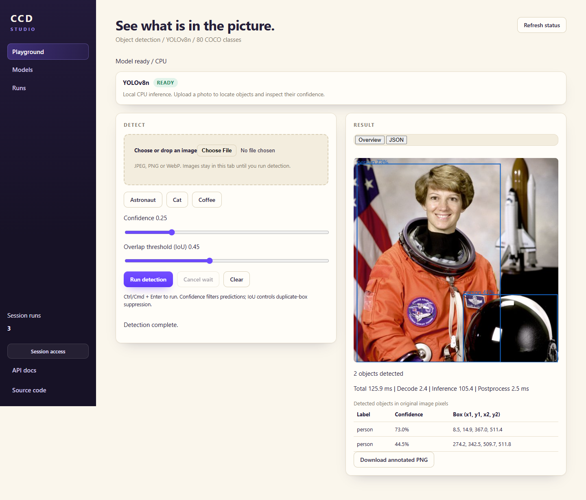
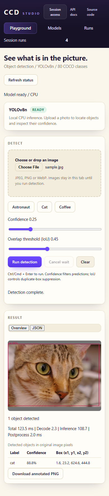

# CPU object-detection serving platform: delivery report

Report date: 2026-10-25. Measurements below were captured 2026-10-23 on the
local Windows 11 / Docker Desktop / Minikube setup. This is a local lab result,
not cloud or production acceptance.

## Executive summary

The delivery is a real CPU object-detection service using a digest-pinned
YOLOv8n ONNX model. FastAPI exposes raw-image detection, health and model
metadata; the Studio displays detections and annotated exports. A hardened
container and single-node Kubernetes deployment with CPU HPA and bounded load
experiments are implemented. The original text-sentiment `/api/inference`
contract was intentionally replaced; see the [scope reconciliation](SCOPE_RECONCILIATION.md)
and [API contract](API_CONTRACT.md).

Local tests, model inference, hardened-container acceptance, browser acceptance,
Terraform formatting/validation/mock-policy tests, and three local scaling runs
are recorded in the [evidence ledger](EVIDENCE.md). A hosted CI run and AWS
deployment were not verified and are not claimed.

## Architecture

The local request path is browser/API client → Kubernetes Service → one to
three serving Pods on one Minikube node. Metrics Server supplies CPU metrics to
the HPA. The optional AWS path is distinct and has not been deployed. The
[architecture guide](ARCHITECTURE.md) contains the diagram and request details.

## Measured local experiment results

Three runs used one baseline VU and eight sustained VUs for 180 seconds. Mean
goodput and latency are the arithmetic means of the three recorded runs.

| Phase | Attempts | Successful detections | Mean successful goodput | Mean success latency | Mean success p95 | Unsuccessful attempts |
| --- | ---: | ---: | ---: | ---: | ---: | ---: |
| Baseline | 175 | 173 | 1.922 req/s | 119.633 ms | 129.183 ms | 2 / 175 (1.143%) |
| Sustained | 134,363 | 5,792 | 10.726 req/s | 371.593 ms | 483.0 ms | 128,571 / 134,363 (95.689%) |

The sustained unsuccessful attempts were 128,547 capacity-related HTTP 429s
and 24 interrupted attempts. There were no invalid 200 response bodies,
unexpected 4xx responses, or 5xx responses. The 429s are not successful
inferences: this workload saturated bounded inference capacity. These numbers
do not establish an SLA or a sustainable throughput target.

| Run | Scale-out to three ready Pods | First scale-in | Return to one ready Pod |
| --- | ---: | ---: | ---: |
| detection-20261023-01 | 39.188 s | 379.289 s | 439.283 s |
| detection-20261023-02 | 84.251 s | 364.245 s | 424.242 s |
| detection-20261023-03 | 84.310 s | 364.316 s | 424.310 s |

The existing run resource samples covered complete Pod CPU/memory metrics in
14/36, 16/36, and 16/36 sustained samples. Baseline coverage was 6/6 per run;
recovery coverage was 90/90, 85/87, and 85/87. The historical runs did not
capture node CPU/memory or host memory, so no node resource measurements are
claimed. The recorder/analyzer now support node metrics and explicit metric-gap
reasons for future runs; existing runs must not be reinterpreted as node data.
See [results/ANALYSIS.md](../results/ANALYSIS.md) for experiment setup and
limitations.

## Verification status

- Recorded test/deployment environment: Windows 11, Docker Desktop/WSL2,
  single-node Minikube Kubernetes `v1.37.0`, with the node limited to 4 CPU and
  6 GiB. Serving containers request 500m/512 MiB and are limited to 1 CPU/1 GiB.
  The October 25 follow-up validation used Python 3.12.14, Node.js 24.14.0,
  Docker client 29.2.1, Minikube 1.39.0, kubectl client 1.34.1, and Terraform
  1.16.6. Those are not retroactively attributed to the October 23 runs. Exact
  host RAM and the historical Docker/Minikube CLI versions were not retained.
  The CI workflow separately pins Node.js 22 and Terraform 1.15.8.
- Original phase-six verification: Python 276 passed; frontend contract suite:
  60 passed (recorded in [EVIDENCE.md](EVIDENCE.md)).
- Follow-up validation: Python 277 passed; frontend contract suite: 60 passed.
- Real model: verified pinned asset and cat/cup/person functional predictions;
  sample detections are not an accuracy benchmark.
- Hardened container: local non-root/read-only acceptance and HTTP rejection
  checks recorded. A resource snapshot is not peak-memory calibration.
- Studio: real Edge browser acceptance recorded. Durable sanitized desktop and
  mobile screenshots are in
  [results/evidence/detection-20261023](../results/evidence/detection-20261023/).
- The desktop capture shows an astronaut sample with an additional person
  detection; this is a known functional false positive, not an accuracy claim.




- Terraform 1.9.8: local format, backend-free init, validate, and eight
  mock-provider tests passed. CI is configured for Terraform 1.15.8, which
  remains unverified without a hosted run.
- Hosted CI: no traceable successful run for the final delivery commit is
  recorded.
- Fresh Minikube deployment was not rerun during this follow-up: the Docker
  Desktop Linux engine was unavailable and no local profile existed.
- AWS: no infrastructure apply, cloud smoke, cloud scaling, CloudWatch
  delivery, or teardown is recorded. AWS remains optional and owner-authorized.

## Presentation, reproduction, and demonstration

The requested eight-slide presentation is
[CCD_Detection_Serving_Project.pptx](CCD_Detection_Serving_Project.pptx).
The [timed demo outline](DEMO.md) is the accompanying 6–7 minute speaker flow;
rehearsal and contribution ownership still need team confirmation.

Fresh Windows local deployment, authentication, HPA inspection and cleanup are
documented in the [runbook](RUNBOOK.md). The compact historical experiment
evidence can be reanalyzed with:

```powershell
python scripts\analyze_experiments.py results\evidence\detection-20261023
```

This replays committed observations and does not rerun load. To generate new
measurements, use the bounded local runner documented in
[loadtest/README.md](../loadtest/README.md). A timed 5–8 minute presentation
outline is in [DEMO.md](DEMO.md); use recorded scaling evidence rather than
waiting for the approximately seven-minute return-to-one interval live.

## Team and contributions

The original specification names Hrit Singh, Aditya Vikram Manocha, and Yoovan
Pattnaik. Individual contributions have not been confirmed, so this report
does not assign implementation or presentation work to any person. Confirm
the contribution split with the team before submission.

## Limitations and follow-up

The local Kubernetes cluster has one node; replicas share node CPU and do not
provide high availability. Metrics Server values are windowed and historical
Pod resource coverage was incomplete. No controlled fixed-replica versus HPA
capacity comparison or agreed sustainable-load target exists. Browser testing
is a documented manual release gate, not a CI job. Hosted CI acceptance,
current account pricing/spend approval, optional AWS deployment, and team
rehearsal remain external decisions or evidence tasks. The course-required
slide deck is included above.

The model and upstream YOLOv8 code are distributed under AGPL-3.0. Review the
[license notice](../models/NOTICE.md) before shipping; this report is not
legal advice.
