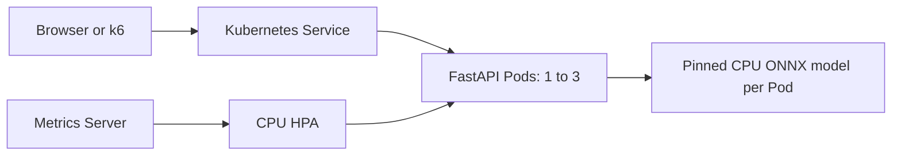

# AI model serving platform: final technical report

## Objective and architecture

The platform serves real CPU sentiment inference and adjusts the number of
ready application replicas as demand changes. FastAPI validates authenticated
requests, dispatches to a pinned quantized DistilBERT ONNX model and exposes
liveness, readiness and metrics. A browser studio supports interactive use.

The model is loaded once per process with bounded concurrent inference. The
container is non-root, has a read-only root filesystem and uses writable cache
and temporary mounts. Baked model assets support offline inference. Kubernetes
readiness gates routing; Metrics Server supplies CPU observations to the HPA.

## Implemented scope

| Area | Delivered behavior and evidence |
| --- | --- |
| Application | Real positive/negative predictions, strict input validation, authentication, health, overload/timeouts, metrics and browser UI |
| Container | Hardened Linux smoke passed; root-owned cache-copy defect fixed and guarded |
| Local Kubernetes | Dedicated Minikube profile, Service routing, offline startup, usable CPU HPA metrics and rollout recovery |
| Experiments | Three actual bounded load/recovery cycles, original summaries/time series, CSV and plots |
| Delivery | CI workflow, manual phase guides, cleanup guards, timed demo and verification ledger |

## Results

Every measured run changed ready replicas from **1 to 3 and back to 1**.
Sustained successful throughput was **104–117 predictions/second**, successful
p95 latency **96–99 ms**, and HTTP 429 rejections approximately **57–59%** of
attempts. The first additional ready replica appeared after **71–84 seconds**;
return to one took **411–424 seconds** after traffic ended. Recorded serving-Pod
restarts, completed 5xx and invalid-200 responses were zero.

The complete method, request accounting, source hashes, image identity and plots
are in [the measured analysis](../results/ANALYSIS.md). These are local measurements
from 22 October 2026, not cloud results. The [verification ledger](VERIFICATION.md)
contains current tests, cleanup observations and hosted CI status.

## Limitations and interpretation

- The single Docker node has an enforced 4 CPU / 6 GiB allocation. Replicas
  share hardware and do not establish high availability or add nodes.
- The load generator shares the node. Unpaced demand caused substantial 429
  rejection; successful-response latency excludes retry delays.
- New-Pod resource metrics were missing for many sustained-load samples.
  Windowed CPU readings lag phase boundaries. Sparse complete-sample averages
  are not representative whole-phase resource utilization.
- Paced baseline and unpaced stress use different offered loads. A fixed-one-Pod
  high-load control is needed to isolate a causal autoscaling speedup.
- This English binary classifier has no neutral class. Confidence is a class
  score, not a calibrated correctness guarantee.
- Mock-tested optional adapters, written cloud infrastructure and workflow
  definitions do not establish real provider, cloud or hosted-CI success.

## Demonstration and reproduction

Follow the README and Phase 1–4 guides from the repository root. The
[demo script](DEMO.md) separates live inference from recorded scaling evidence.
Keep raw measurements before cleanup, use the fixed local context, and stop
the Minikube profile to release compute. Dependencies and model/image identities
are recorded; exact laptop timing is not expected to reproduce identically.

## Team contributions

Names and ownership have not yet been supplied. Complete this table with the
team's confirmed work before submission; repository changes are not evidence
that a particular person performed them.

| Contributor | Confirmed contribution | Supporting work |
| --- | --- | --- |
| Unassigned | Application/model integration | To be confirmed by team |
| Unassigned | Container/Kubernetes | To be confirmed by team |
| Unassigned | Experiments and analysis | To be confirmed by team |
| Unassigned | CI, documentation and demo | To be confirmed by team |

## Deferred extensions

Real optional generation/speech/transcription acceptance, Prometheus/Grafana,
durable asynchronous jobs, Floci integration and AWS deployment are deferred.
EKS is excluded. The local delivery requires no paid provider or cloud account.
