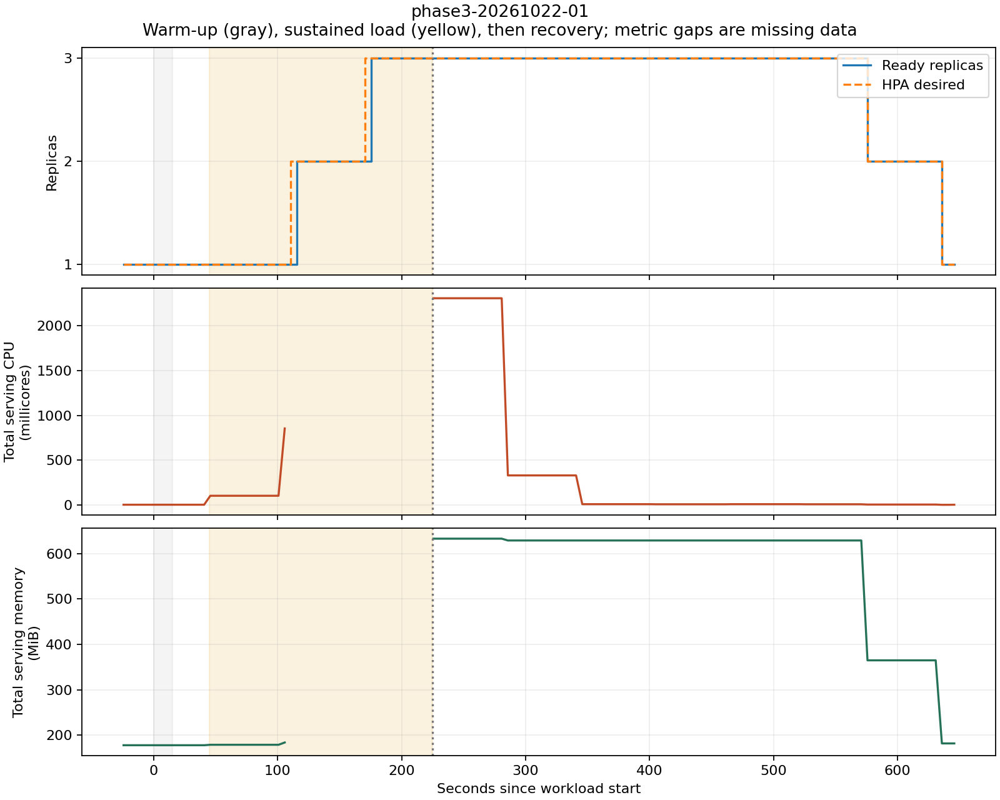

# Phase 3 measured load and autoscaling report

Three local experiments passed: each began with one ready replica, reached
three under load, and returned to one after traffic stopped. Sustained successful
throughput was **104–117 predictions/second**, with **96–99 ms p95 successful
latency**. About **57–59% of attempts were rejected with HTTP 429**. Scaling
worked, but this workload exceeded the service's bounded inference capacity.

Experiments ran on 22 October 2026; final analysis and verification completed
23 October (Asia/Calcutta). Run identifiers retain the measurement date.

## Environment and method

- Windows 11, Docker Desktop/WSL2, Minikube 1.39.0, Kubernetes 1.37.0,
  containerd 2.3.4 and Metrics Server 0.9.0.
- One local Docker node, enforced **4 CPU / 6 GiB** limit. Kubernetes reports
  the larger WSL capacity, 16 CPUs / approximately 11.5 GiB; that is not the
  experiment's enforced allocation. Physical hardware was not remeasured.
- Serving image `ai-model-serving:phase2`; runtime image ID
  `sha256:b35644fc257264f06441a576da503e48f6ee31e110d20a0da404a68d68355a0c`.
  Runtime image IDs and manifest-list digests are different identifiers.
- Pinned DistilBERT ONNX revision
  `0b6928efcb76139cae2c6881d49cda67fe119f42`, baked offline assets, one worker
  per Pod. Each Pod requests 500m CPU / 512 MiB and is limited to 1 CPU / 1 GiB.
- Unchanged HPA: 70% CPU target, 1–3 replicas, at most one additional/removed
  Pod per 60 seconds, 300-second scale-down stabilization. No forced scaling.
- k6 1.8.2 runs inside the same node through Service DNS, with connection reuse
  disabled. Its 500m CPU limit and shared node resources can affect outcomes.
- Each run: 15-second warm-up, 30-second baseline (2 virtual users, 100 ms
  pauses), 180-second sustained phase (8 virtual users, no pauses), then no
  generated traffic until idle recovery. Runs are sequential, with recovery
  between them. Payloads are fixed synthetic English sentiment sentences.
- Successful responses are body/schema validated. Latency uses k6 client
  millisecond timing and includes successful responses only. Warm-up is excluded.
  These checks validate response contracts, not a sentiment-accuracy dataset.

Workload start times in IST: run 01 **19:52:12.784**, run 02 **20:03:00.179**,
run 03 **20:14:01.115**, all on 22 October. Original timestamps use UTC/epoch.

## Measured service outcomes

| Run | Baseline successes / attempts | Baseline successful rps | Baseline mean / p95 ms | Sustained successes / attempts | Sustained successful rps | Sustained mean / p95 ms |
| --- | --- | --- | --- | --- | --- | --- |
| 01 | 528 / 528 | 17.600 | 12.998 / 15 | 21,103 / 48,767 | 117.239 | 43.003 / 97 |
| 02 | 526 / 526 | 17.533 | 13.363 / 15 | 19,183 / 47,174 | 106.572 | 46.127 / 96 |
| 03 | 526 / 528 | 17.533 | 13.251 / 15 | 18,720 / 46,185 | 104.000 | 47.902 / 99 |

| Run | Sustained attempted rps | HTTP 429 | Interrupted sustained attempts | Unsuccessful attempt rate |
| --- | --- | --- | --- | --- |
| 01 | 270.928 | 27,656 | 8 | 56.727% |
| 02 | 262.078 | 27,983 | 8 | 59.336% |
| 03 | 256.583 | 27,457 | 8 | 59.467% |

There were **zero recorded 5xx, invalid-200, other-4xx or other completed-error
responses** in these phases. Run 03's baseline also has two interrupted attempts.
The k6 phase boundaries can cancel in-flight requests; these attempts are retained
as unsuccessful, not silently discarded. They are not observed server errors.
No serving-Pod restarts were recorded.

`throughput_rps` is successes / phase duration. The CSV's `error_rate` includes
429s and interrupted attempts. k6's built-in HTTP failure metric treats 429 as
expected for this overload test, so a zero value there does not mean every
attempt succeeded. Successful-response p95 also excludes time spent retrying
rejected work; it is not end-to-end latency for eventually serving every request.

## Scaling and recovery

| Run | Ready replicas | First additional ready replica after sustained start | First scale-in after load end | Return to one after load end |
| --- | --- | --- | --- | --- |
| 01 | 1 → 3 → 1 | 70.732 s | 350.768 s | 410.775 s |
| 02 | 1 → 3 → 1 | 84.334 s | 364.352 s | 424.369 s |
| 03 | 1 → 3 → 1 | 84.360 s | 364.404 s | 424.405 s |

These are observed ready-replica changes, not merely desired replica counts.
Sampling gaps were at most 5.015 seconds; precision is roughly one sample
interval plus sequential API-read and k6 setup-return overhead. Extra digits
preserve the calculation, not millisecond accuracy. Scale-in delays include
metrics lag, reconciliation and the configured stabilization/scaling policy.

Additional figures: [run 02](figures/phase3-20261022-02.png),
[run 03](figures/phase3-20261022-03.png). Yellow denotes sustained traffic;
resource-line gaps mean missing data.

## Resource measurements and limitations

All six baseline samples per run had complete serving-Pod metrics. During
sustained load, complete coverage was only **14/36, 16/36 and 16/36 samples**.
New Pods appeared before Metrics Server supplied their usage. The analyzer
rejects partial sums rather than reporting them as whole-service consumption.
Recovery coverage was 85/85, 85/87 and 85/87 samples.

The CSV retains resource means over complete samples, with coverage in its notes.
Those sparse sustained means are **not representative whole-phase utilization**.
`kubectl top` supplies windowed metrics without their original timestamps in this
capture; readings retrieved after traffic ends still reflect earlier activity.
This explains the high apparent CPU at the start of recovery and the low baseline
readings. Resource plots establish observed usage and missingness, not precise
phase-aligned utilization, CPU efficiency or a memory-leak assessment.

The baseline is paced and sustained traffic is unpaced. Their throughput
difference does not isolate the benefit of autoscaling. A causal comparison
would require the same high-load workload with a fixed one-replica control.
Three repetitions on one laptop are not a production capacity guarantee.
Additional replicas share fixed hardware; this is not node scaling or high
availability. Cold starts, long-running soak tests, optional models, cloud
performance and hosted CI were not measured here.

## Evidence and implementation corrections

- [Nine measured CSV rows](performance.csv): baseline, sustained and recovery
  for each run. Recovery request/latency fields are blank because no recovery
  requests were generated.
- [Derived measurements, hashes and HPA configuration](evidence/phase3-20261022/derived.json).
- [Preserved evidence](evidence/phase3-20261022/): per-run original summaries,
  timestamps, JSONL samples, completion records, measured source snapshots,
  Job template, node limits and generator image identities. Full raw logs and
  initial Kubernetes environment remain under ignored `results/raw/phase3-20261022/`.
- Source snapshot hashes match the captured provenance. The Git HEAD is recorded,
  but the working tree was dirty; HEAD alone does not identify the measured code.

Two reporting defects were corrected after the experiments had started. The
recorded k6 aggregate `attempts_total` counts completed requests; the analyzer
uses the correct **per-phase pre-request attempt counters** instead. Current k6
code corrects that aggregate and reports completed requests separately. Also,
the original recorder looked for the CPU target in HPA status, yielding null;
the verified 70% target comes from the captured HPA **spec**. Current code reads
the spec correctly. The measured snapshots and raw values are preserved without
rewriting them to look like the corrected implementation. These corrections
do not change the per-phase throughput, errors or ready-replica timing above.

The runner now automatically snapshots its measured sources. The results-schema
test now parses CSV quoting correctly. Regression checks cover request accounting,
missing readiness/metrics, HPA targets, phase boundaries and scaling calculations.
Final local suite: **296 passed, no skips**, on 23 October 2026.

## Reproduce and remaining work

Follow [PHASE_3.md](../docs/PHASE_3.md) for the commands and expected observations.
Use a fresh run prefix, wait for idle recovery, then run the analyzer. Inspect
the CSV and source evidence rather than expecting identical timing numbers.

Phase 3's local load/scaling evidence gate is complete. Phase 4 still needs
same-commit hosted CI, final demo/report assembly and cleanup acceptance. Optional
cloud/provider work remains separate. The cluster is left running with one ready
serving Pod; completed benchmark Jobs remain for inspection.
